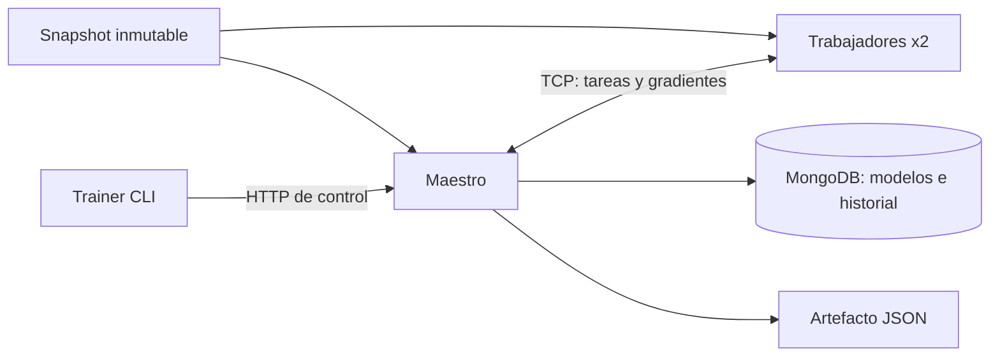

# Pasos 4 y 5: modelo secuencial y clúster TCP

Verificación: 12 de octubre de 2026. Cambios locales, sin commit ni publicación externa.

Este documento conserva la evidencia de la primera versión. El modelo actual, su mejor calidad, la recuperación del maestro y la demo se documentan en [PASOS_6_7.md](PASOS_6_7.md).

## Resultado de implementación

| Paso | Estado | Evidencia |
|---|---|---|
| 4. Modelo secuencial | Completado | Normalización de train, modelo Go, SGD, baseline, métricas, artefacto serializado y recarga comprobada. |
| 5. Clúster mínimo | Completado | Maestro y dos contenedores de trabajadores; tareas y gradientes reales por TCP; equivalencia y fallo controlado comprobados. |

Los servicios se dejan levantados: MongoDB, Redis, API de datos, maestro y dos trabajadores. La API de predicciones y la pantalla todavía no están implementadas. El control temporal de entrenamiento se consulta directamente en el HTTP del maestro, solo publicado en `127.0.0.1`.

## Modelo y experimento reproducible

Se usa el snapshot `raw-counts-v1` de 75.481 ejemplos, con 52.600 train, 11.309 validation y 11.572 test. El archivo y sus splits conservan el checksum generado por el loader.

Regresión lineal regularizada sobre `log1p(conteo)`, entrenada mediante mini-batch SGD. Las features son zona y día categóricos, seno/coseno de hora, fin de semana y `log1p(lag1_count)`. La codificación tiene 275 parámetros, incluido el intercepto. Media y escala se ajustan únicamente sobre train; las zonas también se obtienen de ese split. La inferencia reutiliza el mismo encoder.

Inicialización: el peso del lag y el intercepto reproducen la persistencia del intervalo anterior en escala logarítmica. Se trata de una inicialización reproducible basada en features, no de un ajuste con etiquetas de test. El optimizador luego ajusta los parámetros con train.

Configuración fijada antes de evaluar test: 30 épocas, lote global 1.024, learning rate 0,04, L2 0,0001 y semilla 42. Se realizaron 1.560 actualizaciones. La versión distribuida reparte cada lote entre dos trabajadores y realiza una única actualización en el maestro.

Modelo secuencial de la reproducción final: `run-b8f32b131b996a6c723a12a6`.

Modelo distribuido de esa reproducción: `run-0bf12e20593d5b8b04aade9f`.

Máxima diferencia absoluta entre parámetros: **5,7246e-17**, dentro de la tolerancia de verificación `1e-9`. Los dos trabajadores contribuyeron a 1.560 tareas parciales cada uno. Por tanto, se verificó trabajo distribuido real; el contador no representa actualizaciones adicionales del modelo.

### Calidad medida

| Métrica en test | Modelo SGD | Baseline: conteo anterior |
|---|---:|---:|
| MAE en viajes por ventana | 1,44447 | 1,23842 |
| RMSE en viajes por ventana | 4,60907 | 3,69519 |
| Media de `0.5 * error_log²` | 0,0541083 | 0,0553119 |

La pérdida online de entrenamiento pasó de 0,0660991 en la primera época a 0,0646991 en la última. El modelo mejora el objetivo logarítmico, pero **todavía no supera al baseline en MAE/RMSE de conteos**. Esa meta de calidad permanece pendiente. No se ajustaron hiperparámetros usando test después de observar estos resultados; las siguientes mejoras deben seleccionarse con validation y evaluarse con el protocolo correspondiente.

### Tiempos de la reproducción final

| Etapa | Secuencial | Distribuido con dos trabajadores |
|---|---:|---:|
| Preparación del snapshot/encoder | 2,8806 s | 5,1604 s |
| Entrenamiento | 0,4012 s | 2,1624 s |

Ambos servicios fijan `GOMAXPROCS=1` por proceso. Estas observaciones son comprobaciones funcionales, sin hardware dedicado ni un protocolo de benchmark con cinco repeticiones. En la muestra actual, el trabajo numérico es pequeño y el protocolo añade coste: **no se ha demostrado speedup**. El análisis con 1/2/4 trabajadores, tiempos de comunicación y volúmenes mayores pertenece a los pasos de medición del plan.

## Arquitectura y sincronización



Una goroutine de entrenamiento es dueña de los pesos y de las actualizaciones. El registro de conexiones y los snapshots de progreso usan un mutex; cada conexión serializa escrituras. Las respuestas entrantes tienen una cola acotada. Los pesos no se comparten con los trabajadores mediante memoria ni por un archivo mutable.

El snapshot de entrada se monta en solo lectura para los trabajadores; cada proceso lo verifica y prepara. No se transporta el dataset completo en cada paso. Cada tarea contiene los índices de su parte del batch y una versión de parámetros. Es un despliegue de procesos distribuidos en un host; los volúmenes locales no resuelven una futura ejecución entre máquinas.

### Protocolo implementado

- Encabezado de longitud de cuatro bytes, big-endian, seguido de JSON; máximo 4 MiB.
- Versión de protocolo 1, registro de worker ID único y sesión nueva en cada conexión.
- `prepare/ready` valida que los procesos tengan la misma cantidad de ejemplos de train.
- `task/gradient/ack` identifica run, paso, tarea, intento y versión del modelo.
- Heartbeat cada dos segundos; maestro vence lecturas a los diez segundos y el trabajador a los doce. El heartbeat sigue funcionando durante el cálculo.
- Timeout de preparación de treinta segundos y timeout independiente de tarea, configurable en el JSON de entrenamiento.
- Gradientes deben tener dimensiones, conteo y valores finitos correctos. Se reduce en orden de tarea, ponderando por cantidad de ejemplos; la regularización se aplica solo en el maestro.
- Respuestas duplicadas o de otra versión/paso se rechazan y fallan el run. Un gradiente nunca contribuye dos veces a una actualización.

Si falta una contribución, no se utiliza un batch incompleto. Las actualizaciones intermedias son privadas; el modelo nuevo se publica solo después de terminar y evaluar el entrenamiento. Una caída provoca fallo explícito y reconexión para trabajos posteriores. No hay reasignación de tareas ni reanudación del run fallido todavía.

## Artefactos y persistencia

Cada artefacto contiene versión, dataset y checksum, encoder/vocabulario/normalización, pesos, configuración, horizonte, zona horaria, cortes temporales, historial de pérdida y métricas por split. Se guarda como JSON en `data/models/<run_id>.json` y como documento en `models` de MongoDB. `settings.current_model` apunta a una versión completa. Historial y tiempos quedan en `training_runs`.

Progreso por paso se mantiene en memoria durante el run; MongoDB guarda el estado inicial y el resultado final. La recuperación automática tras caída del maestro, leases y checkpoints quedan pendientes en la etapa de recuperación del plan.

Se comprobó que recargar el artefacto desde JSON y MongoDB produce las mismas predicciones. Candidatos con pesos no finitos no se publican y conservan el modelo anterior.

## Pruebas realizadas

Pasaron `go test -race -count=1 ./...` y `go vet ./...` en Docker, incluyendo:

- Gradiente contrastado con diferencias finitas.
- Normalización/vocabulario sin usar validation o test.
- Pérdida descendente en fixture de aprendizaje y serialización sin cambiar predicciones.
- Equivalencia de actualizaciones con particiones de tamaños desiguales.
- Lectura de frames TCP fragmentados/concatenados y rechazo de frames truncados, grandes o de otra versión.
- Entrenamiento secuencial y TCP con 1, 2 y 4 clientes sobre fixture; esos casos no sustituyen el benchmark de cuatro contenedores.
- Gradiente duplicado: run fallido y modelo anterior intacto.
- Trabajador que no responde: timeout y run fallido, sin publicar.
- Rechazo de un segundo run distribuido mientras otro está activo.
- Integración MongoDB de carga, entrenamiento, historial y recarga desde archivo/base.

Además, durante un entrenamiento real se detuvo un contenedor de trabajador. El maestro falló el run `run-397fa1f7e2162394b2e16828` y mantuvo la versión anterior `run-44739dd0902fd5b008232186`. Se restauraron ambos trabajadores y el script de reproducción volvió a completar otro entrenamiento.

Las pruebas de red se ejecutan en Docker porque el sandbox de ejecución nativa bloquea sockets locales. La workflow está preparada pero no se publicó ni ejecutó remotamente.

## Reproducción y control

```powershell
./scripts/train-demo.ps1
```

Resultados completos en `data/training-sequential.json`, `data/training-distributed.json`, `data/training-comparison.json`. Prueba de caída real en `data/cluster-failure-check.json`. Todos están ignorados como artefactos generados; este documento conserva el resumen de evidencias.

HTTP del maestro:

- `GET /health/ready`: disponibilidad de persistencia.
- `GET /cluster`: trabajadores, sesión, heartbeat, estado y tareas aceptadas.
- `POST /runs`: configuración de entrenamiento, respuesta 202 con run ID.
- `GET /runs/{id}`: progreso o resultado persistido.
- `GET /models/current` o `GET /models/{version}`: artefacto completo.

Por defecto: `http://127.0.0.1:8081`. TCP 9000 se mantiene interno a Docker; cada worker se conecta a `master:9000`. No hay `container_name` fijo para el servicio escalable.

## Continuación

Pasos 6 y 7: cargar el modelo publicado en la API, construir features históricas de consulta, servir predicciones versionadas y conectar la pantalla con progreso del clúster. También siguen pendientes la mejora predictiva, el speedup medido, JWT/WebSocket/Redis para predicciones y recuperación avanzada.
