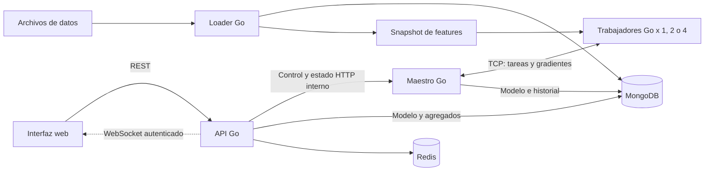

# Plan de desarrollo del Proyecto 9

Fecha de revisión: 12 de octubre de 2026. Prioridad: llegar pronto a una demo usable y continuar desde ella hasta completar el proyecto. Este plan no distribuye tareas entre integrantes ni supone una fecha de entrega.

Actualización: se implementaron y verificaron los pasos **1 a 7**. Hay demo local con datos reales, dos trabajadores TCP, predicciones versionadas, Redis, pantalla y entrenamiento desde el navegador. Evidencias en [PRIMEROS_PASOS.md](PRIMEROS_PASOS.md), [PASOS_4_5.md](PASOS_4_5.md) y [PASOS_6_7.md](PASOS_6_7.md). La revisión siguiente describe el punto de partida anterior a esa implementación.

Actualización de alcance: **las semanas 7 a 10 del cronograma están completas**, con 1,348,665 viajes válidos, JWT, WebSocket, SPA React y telemetría real CPU/RAM/pérdida. Matriz de las 14 actividades en [SEMANA_7_10.md](SEMANA_7_10.md). La numeración de semanas del Excel y la numeración de pasos de este plan son distintas. Escalabilidad con cuatro workers, benchmarks y validación en otra computadora siguen pendientes.

## 1. Qué está confirmado y qué falta

Se revisaron las tres páginas de `C:/Users/axela/Downloads/Guia_Proyecto9_Contexto.pdf`, el árbol del repositorio, las ramas locales y referencias remotas disponibles, y las herramientas accesibles en esta sesión.

| Aspecto | Resultado de la revisión |
|---|---|
| Clúster en el diseño | Sí. La guía describe un maestro y trabajadores independientes, comunicados por TCP, con el patrón parameter server. |
| Varias computadoras obligatorias | La guía de contexto dice que bastan varios contenedores Docker. La rúbrica original no está adjunta; no se ha verificado por separado esa interpretación. |
| Clúster implementado en este checkout | No. El repositorio tenía únicamente un README con el nombre del proyecto y el commit inicial. No había servicios, módulos Go, Compose, pruebas ni datos. |
| Clúster ejecutándose en Docker local | No se pudo comprobar: el cliente está instalado, pero el motor `desktop-linux` no es accesible. Esto no demuestra que no existan contenedores guardados u otros entornos remotos. |
| Herramientas | Docker CLI y Compose disponibles; Go no localizado en PATH. Se puede construir y probar Go dentro de una imagen de desarrollo. |
| Infraestructura externa | No se proporcionaron servidores, credenciales ni acceso a un clúster remoto. |

La conclusión de la revisión inicial fue: **había un clúster previsto y todavía había que construirlo**. Ese diagnóstico dio origen al plan; la implementación actual y su estado se describen en la actualización al inicio de este documento.

Un conjunto de contenedores en un host permite demostrar procesos separados y comunicación por red. Su capacidad de CPU, disco y memoria sigue dependiendo de esa computadora. Compose normal despliega en un host; distribuir contenedores entre máquinas requiere otra configuración u orquestación. [Documentación oficial de Docker](https://docs.docker.com/compose/how-tos/production/).

## 2. Alcance y decisiones para avanzar rápido

Los elementos solicitados por la guía son: cargador concurrente, entrenamiento distribuido en Go por TCP, MongoDB, Redis, API REST, JWT, WebSocket, interfaz, despliegue con Compose y mediciones. Son el contexto de la entrega. La decisión de priorizar una demo y el orden de implementación de este documento responden a la solicitud actual del usuario.

Prioridades:

- **P0: demo usable.** Datos reales, procesamiento básico concurrente, entrenamiento secuencial y distribuido con dos trabajadores, persistencia, API y una pantalla conectada a todo lo anterior.
- **P1: completar requisitos y demostrar resultados.** Cuatro trabajadores, mapa, recuperación controlada y mediciones reproducibles. Más de un millón de viajes válidos, Redis, JWT y WebSocket ya están implementados.
- **P2: mejorar después.** Perfilado avanzado, modelos alternativos, automatización adicional y despliegue entre máquinas si llegara a ser necesario.

P0 constituye un primer corte funcional importante. No equivale a una afirmación de haber completado el 50% de la rúbrica: el rendimiento y los requisitos pendientes necesitan evidencias propias.

### Decisiones de tecnología

| Elemento | Propuesta | Motivo |
|---|---|---|
| Procesamiento, ML, maestro, trabajadores, API | Go, un módulo compartido | Mantener el núcleo alineado con la guía y reutilizar el cálculo secuencial en los trabajadores. |
| HTTP | Biblioteca estándar `net/http` | Pocos endpoints y menor preparación inicial. |
| Comunicación de entrenamiento | TCP con mensajes JSON delimitados por longitud | Protocolo explícito, fácil de observar y validar; optimizar la codificación solo si las mediciones lo justifican. |
| Persistencia | MongoDB | Datos limpios, agregados, modelos e historial. |
| Caché | Redis | Ya incorporado en P0, con versión de modelo en cada clave y fallback. |
| Pantalla inicial | SPA React compilada y servida por Go | Formulario, métricas, impacto y estado por REST/WebSocket. |
| Mapa posterior | GeoJSON y una biblioteca de mapas estable, por ejemplo Leaflet | Permite representar zonas sin programar un visor geográfico desde cero. |
| Ejecución | Docker Compose | Una configuración reproducible con trabajadores escalables. |
| Verificación | Pruebas Go, detector de carreras, integración y mediciones propias | Cubrir corrección numérica, concurrencia y contratos entre procesos. |

El navegador necesita HTML/CSS y, para la interacción propuesta, JavaScript. La guía dice que todo se escribe en Go, pero también muestra una SPA con `package.json`. Este plan interpreta Go como lenguaje del núcleo y los servicios. Si existe una restricción literal distinta en el enunciado original, habrá que ajustar la interfaz. No hace falta Node para la pantalla inicial propuesta.

## 3. El problema social y la elección de datos

**No se puede deducir demanda no atendida únicamente contando viajes realizados.** Pocos viajes pueden significar poca demanda, poca oferta, cobertura incompleta del dataset o una combinación. Tampoco permiten afirmar por sí solos que las zonas con menos recursos están desatendidas.

Para la primera demo, la pregunta operativa será:

> ¿Qué actividad de transporte observada se espera por zona en el siguiente intervalo de 15 minutos?

El modelo pronosticará conteos de viajes observados, presentados como aproximación parcial de actividad o demanda servida. La pantalla mostrará fuente, período y limitación. Si la pregunta de demanda no atendida es obligatoria en la evaluación, la decisión sobre datos adicionales debe resolverse en el paso 2; esta aproximación no sustituye ese requisito.

### Fuente propuesta

Usar un período histórico fijo de **NYC TLC Yellow Taxi** para arrancar. La fuente publica viajes y sus zonas; los archivos se ofrecen en Parquet. No asumir que el archivo de origen es CSV. [Portal oficial de TLC](https://www.nyc.gov/site/tlc/about/tlc-trip-record-data.page).

El loader debe tener un adaptador de Parquet desde el inicio si se usa esa fuente. CSV se mantiene como adaptador para fixtures y para una posible exportación reproducible. No descargar todos los años: elegir un mes completo, contar los registros válidos y ampliar el período si no alcanza el requisito de escala.

Para ampliar el análisis social, evaluar **High Volume FHV**. Su diccionario incluye `request_datetime` y `pickup_datetime`; su diferencia permite estudiar el tiempo observado entre solicitud y recogida en los viajes registrados. `on_scene_datetime` tiene una cobertura específica de vehículos accesibles y no sirve como indicador universal. [Diccionario oficial HVFHV](https://www.nyc.gov/assets/tlc/downloads/pdf/data_dictionary_trip_records_hvfhs.pdf).

La conclusión de que estos tiempos no miden todas las solicitudes rechazadas o canceladas es una limitación inferida del alcance de los registros de viajes. Para medir demanda realmente no cubierta hacen falta solicitudes no atendidas y datos de oferta, con definiciones compatibles. Si no se consiguen, el informe debe delimitar la pregunta y dejar abierta esa parte, no inventar etiquetas de escasez.

### Contrato de datos propuesto

| Entidad | Campos principales |
|---|---|
| `DatasetManifest` | Fuente, URL, período, SHA-256 de cada archivo, esquema, zona horaria, filas de origen/válidas/rechazadas, versión del procesamiento. |
| `Trip` | `dataset_id`, archivo y ordinal de origen, inicio/fin, zona origen/destino, duración y campos adicionales realmente disponibles. |
| `ZoneWindow` | Dataset, zona, inicio de ventana, conteo observado y estado de cobertura. |
| `FeatureSnapshot` | Dataset, versión de features, esquema/orden, divisiones temporales, normalización y manifiesto de particiones con checksum. |
| `ModelArtifact` | Versión, pesos, bias, esquema de features, normalizador, ventanas de entrenamiento, semilla, configuración y métricas. |
| `TrainingRun` | ID, dataset/snapshot, trabajadores, estado, pasos, pérdida, tiempos, errores, modelo candidato y versión publicada. |

Usar el archivo y ordinal de origen para hacer la carga repetible; no eliminar viajes diferentes solo por coincidir en hora y zona. Datos faltantes no se transforman automáticamente en cero. Completar ventanas con cero solo donde se haya definido y documentado cobertura observada suficiente; esto no garantiza cobertura de toda la movilidad de la ciudad.

La zona horaria del dataset se declara en el manifiesto. Para Nueva York se validará el tratamiento de la hora local y los cambios de horario. Guardar timestamps inequívocos y separar la hora local usada como feature. No interpretar estas horas como hora de Lima.

## 4. Arquitectura propuesta



### Límites y responsabilidades

**Loader:** leer por bloques, validar, transformar, contabilizar rechazos, guardar datos limpios por lotes y generar features. Es un trabajo de duración finita; no tiene que permanecer encendido para consultar predicciones.

**Maestro:** registrar trabajadores, asignar tareas, poseer los parámetros, agregar gradientes, aplicar las actualizaciones y publicar modelos terminados. Un solo entrenamiento activo en la primera versión. Su bucle de coordinación es dueño exclusivo del estado mutable del modelo.

**Trabajador:** conectarse al maestro, cargar/cachear las particiones asignadas, calcular gradientes y devolver resultados. No escribe pesos ni publica modelos. Las goroutines dentro del trabajador son un segundo nivel de concurrencia y se presupuestan por separado.

**API:** recibir solicitudes del usuario, iniciar trabajos sin bloquear, consultar al maestro, servir predicciones desde un modelo inmutable en memoria y leer agregados. Expone la coordinación del clúster al usuario; el maestro conserva la autoridad sobre tareas y trabajadores. Evitar dos registros independientes de miembros que puedan contradecirse.

**Web:** formulario de zona y período, resultado, actividad observada, versión del modelo, estado del entrenamiento y trabajadores. WebSocket ya actualiza el estado; el mapa queda para una ampliación.

**MongoDB:** fuente persistente de datos procesados, metadatos y artefactos. **Redis:** caché prescindible para la corrección de una predicción, con acceso acotado por timeout.

### Recorrido completo

1. Descargar y verificar archivos de un período fijo.
2. Procesar y persistir viajes válidos; publicar el dataset únicamente al finalizar correctamente.
3. Agregar por zona y ventana; generar un snapshot inmutable de features.
4. Entrenar primero en modo secuencial y después mediante maestro/trabajadores.
5. Guardar el artefacto completo como candidato; publicarlo cuando las validaciones pasan.
6. La API carga una copia inmutable del modelo publicado.
7. La interfaz consulta el siguiente intervalo desde un origen de predicción explícito y obtiene resultado y versión.
8. Se muestran progreso y resultados medidos, incluyendo las limitaciones del dataset.

La inferencia no depende de que haya entrenamiento activo. Entrenar y consultar son operaciones separadas.

### Servicios y red

| Servicio Compose | Puertos propuestos | Persistencia/acceso |
|---|---|---|
| `master` | TCP 9000 y HTTP interno 8081 | MongoDB y snapshot. |
| `worker` escalable | Conexiones salientes al maestro | Snapshot de features en solo lectura. |
| `api` | HTTP 8080 interno | MongoDB y Redis. |
| `web` | HTTP 3000 interno; publicar en loopback | Archivos estáticos y proxy hacia API. |
| `mongo` | 27017 interno | Volumen nombrado. |
| `redis` | 6379 interno | Caché; no es el almacén de modelos. |
| `loader` | Ninguno; ejecución por perfil/job | Datos de entrada y snapshot derivado. |

P0: maestro + dos trabajadores + API + web + MongoDB + Redis = **7 contenedores persistentes**; loader y trainer se ejecutan aparte. Redis ya participa en predicción. Con cuatro trabajadores serán 9 contenedores persistentes.

No declarar `container_name` en el servicio escalable `worker`; cada instancia se registra con un identificador único. Resolver `master`, `mongo` y `redis` por nombre de servicio. Incorporar health checks, espera de readiness y reintentos acotados: el orden de arranque por sí solo no garantiza disponibilidad.

El despliegue local publicará la web en `127.0.0.1`. Los servicios de entrenamiento y las bases quedan en la red interna. La demo permanece en loopback; JWT ya protege las rutas de proyecto.

## 5. Procesamiento concurrente y modelo inicial

### Loader

Pipeline propuesto: lector de bloques -> canal acotado -> pool de validación/transformación -> agregador y escritor por lotes -> resumen final.

En CSV, los bloques deben respetar registros completos, incluyendo campos entrecomillados y saltos de línea internos. En Parquet, repartir archivos o grupos de filas con lectores adecuados; no compartir un decodificador mutable entre goroutines sin garantizar su seguridad.

Empezar con límites configurables de bloque, número de trabajadores y lote de escritura. Aplicar backpressure para que el consumo de memoria no crezca sin límite. Registrar filas leídas, válidas, rechazadas por causa y efectivamente persistidas. Si falla la escritura, el dataset no se marca como completo.

La agregación tendrá una ruta secuencial y una concurrente que deben producir los mismos conteos. Para la demo basta concurrencia en un loader; no confundir este pool con los procesos distribuidos del entrenamiento.

### Modelo P0

La primera versión usó regresión sobre `log1p(conteo)`, pero empeoró frente al baseline. La versión actual **`linear-count-v2`** usa conteos normalizados, mini-batch SGD, un coeficiente de lag por zona y selección de mezcla con persistencia mediante validación temporal. Ajusta normalización solo en train y convierte la salida a conteos no negativos. Si validación no encuentra una mejora de MAE sin empeorar RMSE, publica explícitamente persistencia. Se mantiene lectura del artefacto anterior para compatibilidad.

Features iniciales propuestas: zona categórica, hora con codificación cíclica, día de semana, fin de semana y, cuando exista historial suficiente, conteos de intervalos anteriores. No usar el ID de zona como variable numérica ordinal.

Para cada origen temporal `t`, predecir la ventana siguiente. Las features históricas solo pueden usar datos disponibles hasta `t`. La inferencia P0 se hará como **reproducción histórica**, con orígenes dentro del período cargado; la UI no ofrecerá fechas futuras arbitrarias si no puede construir sus features. Exponer a la interfaz los períodos y zonas disponibles.

Dividir entrenamiento, validación y prueba por tiempo, con proporciones iniciales 70/15/15 y cortes explícitos. Ajustar normalización únicamente sobre entrenamiento. Evaluar MAE y RMSE en la escala original y comparar con un baseline temporal simple calculado únicamente con información disponible. Reutilizar el mismo código de features en entrenamiento e inferencia.

Si el modelo no supera el baseline, conservar esa evidencia y revisar features/configuración. El MVP puede demostrar el sistema aunque la mejora predictiva todavía sea insuficiente; no presentar esa situación como éxito del modelo.

El requisito de más de un millón de registros corresponde al volumen de origen/procesamiento. Las ventanas agregadas pueden ser muchas menos. Informar ambos conteos: **un millón de viajes no implica un millón de ejemplos de entrenamiento**.

## 6. Contrato del entrenamiento distribuido

### Algoritmo inicial: SGD síncrono

Para cada paso, todos los trabajadores calculan sobre la misma versión de parámetros. El maestro espera el conjunto de tareas del batch global, agrega y realiza una sola actualización. La primera implementación prioriza equivalencia numérica y trazabilidad.

Si cada trabajador devuelve la suma de sus gradientes `G_i` y el número de ejemplos `n_i`:

```text
G = (suma de G_i) / (suma de n_i)
theta_siguiente = theta_actual - learning_rate * (G + gradiente_regularizacion)
```

Aplicar la regularización una sola vez en el maestro. Promediar sin ponderación los gradientes de particiones desiguales puede dar un resultado incorrecto.

Mantener constantes el batch global, la semilla, el orden de ejemplos y la cantidad de pasos cuando se compara 1, 2 y 4 trabajadores. Repartir cada batch global entre trabajadores; no multiplicarlo por el número de procesos. La versión secuencial calcula esos mismos batches.

### Protocolo TCP

Usar un encabezado de longitud fija seguido del mensaje JSON; definir un tamaño máximo, deadlines, versión de protocolo y un único escritor por conexión. TCP transporta un flujo de bytes: una lectura no corresponde necesariamente a un mensaje.

| Mensaje | Información imprescindible |
|---|---|
| `Register` / `RegisterAck` | Versión de protocolo, worker ID, sesión, capacidades. |
| `Heartbeat` | Sesión, estado y último trabajo conocido. |
| `Task` | Run ID, step ID, task ID, intento, model version, snapshot/shard, rango de ejemplos y parámetros. |
| `Gradient` | Los mismos identificadores, cantidad de ejemplos, suma de gradientes, suma de pérdidas y tiempo de cómputo. |
| `Ack` / `Reject` | Tarea, intento y motivo. |
| `Stop` / `Error` | Run ID, causa y estado final. |

Rechazar dimensiones incorrectas, valores no finitos, sesiones no vigentes, versiones antiguas y gradientes duplicados. Ordenar la reducción por task ID para reducir variaciones entre ejecuciones.

Una goroutine del maestro mantiene el estado; los lectores de conexiones entregan eventos por canales. Esto evita escrituras concurrentes de pesos. Copiar el snapshot enviado a trabajadores y el publicado para inferencia: compartir un slice mutable puede reintroducir carreras.

### Datos y fallos

El snapshot derivado puede almacenarse en archivos particionados con manifiesto y checksum, como caché reproducible de MongoDB. En Compose local, un volumen compartido de solo lectura permite a cada trabajador cargar sus rangos sin transportar todo el dataset en cada paso. Los pesos se coordinan por TCP; no por ese volumen.

Para varias máquinas se necesitaría replicar esas particiones verificadas o incorporar almacenamiento accesible por red. El volumen local no resuelve esa extensión.

En P0, si falta un trabajador o vence un deadline, el entrenamiento pasa a fallido de forma explícita; no se actualiza con un batch incompleto. Se conserva el último modelo publicado para consultas. En P1, reasignar la misma tarea con un intento nuevo y descartar la respuesta del intento anterior. Una tarea contribuye como máximo una vez al paso.

Heartbeat propuesto: cada 2 segundos, timeout inicial de 10 segundos, ambos configurables. Los deadlines de cómputo son independientes: una tarea larga no significa necesariamente que un trabajador esté muerto.

Guardar checkpoints en P1 con pesos, paso, configuración, estado del orden de batches y snapshot. El maestro es un punto único de fallo en esta propuesta; recuperación desde checkpoint no equivale a alta disponibilidad.

## 7. API, modelos publicados y pantalla

### Endpoints propuestos

| Endpoint | Uso | Prioridad |
|---|---|---|
| `GET /health/live` y `GET /health/ready` | Salud y disponibilidad. | P0 |
| `GET /api/v1/datasets/current` | Conteos, fuente, zonas y período disponible. | P0 |
| `GET /api/v1/zones` | Catálogo de zonas; GeoJSON en P1. | P0/P1 |
| `GET /api/v1/cluster` | Trabajadores registrados, estado y actualización del maestro. | P0 |
| `POST /api/v1/training-runs` | Iniciar un trabajo; devolver `202` y run ID. | P0 |
| `GET /api/v1/training-runs/{id}` | Consultar progreso, configuración, métricas y errores. | P0 |
| `POST /api/v1/predictions` | Zona, origen temporal y horizonte de 15 minutos; resultado versionado. | P0 |
| `GET /api/v1/observations` | Agregados de actividad, paginados o con rangos acotados. | P0 |
| `POST /api/v1/auth/login` | Acceso con usuario de demo configurado y token firmado. | P1 |
| `GET /api/v1/events` | Upgrade a WebSocket para progreso y estado. | P1 |

La API se comunica con un endpoint HTTP interno del maestro para iniciar el trabajo y leer estado. Si ya hay un entrenamiento activo, responder conflicto; una caída del maestro debe producir un error identificable, no quedar esperando indefinidamente.

Ejemplo conceptual de respuesta de predicción:

```json
{
  "zone_id": 161,
  "forecast_origin": "2024-01-15T09:00:00-05:00",
  "horizon_minutes": 15,
  "predicted_observed_trips": 42.7,
  "model_version": "run-demo-001",
  "dataset_id": "tlc-yellow-periodo-fijo",
  "feature_snapshot_id": "snapshot-001",
  "cache_hit": false,
  "data_scope": "recorded_completed_trips"
}
```

Los valores anteriores son ilustrativos; no son resultados medidos ni datos ya disponibles en este repositorio. La UI debe informar ausencia de modelo, zona desconocida, período sin features y errores de servicio. No rellenar con resultados ficticios al fallar la API.

### Publicación y caché

Guardar un artefacto completo e inmutable con su configuración, y después actualizar el puntero a modelo activo. La API cambia el snapshot completo de manera atómica y mantiene el anterior hasta que el nuevo esté listo.

Clave Redis propuesta: versión del modelo + snapshot de features + zona + origen temporal + horizonte. De esta forma, publicar otro modelo no reutiliza predicciones del anterior. Si Redis falla, calcular con el modelo en memoria, con timeout corto de caché. No cargar el modelo desde MongoDB en cada solicitud.

En P1, validar firma, expiración, issuer y audience de JWT. Mantener claves fuera de Git. Para WebSocket, validar origen y autenticar el handshake mediante un mecanismo compatible con el navegador, como una cookie segura en el despliegue correspondiente; evitar tokens permanentes en URL. Acotar colas de eventos y desconectar clientes demasiado lentos.

### Demo P0 visible

Una única pantalla con:

1. Fuente, período y filas válidas/rechazadas.
2. Selector de zona y origen temporal disponible.
3. Predicción del siguiente intervalo y actividad histórica comparable.
4. Estado de maestro y dos trabajadores, con última actualización.
5. Botón de entrenamiento, progreso y pérdida.
6. Identificación del modelo activo y estado de errores.

El refresco inicial de progreso puede ser polling cada pocos segundos. WebSocket reemplaza ese mecanismo en P1. El mapa es P1 para acelerar la demo: la primera tabla debe responder una consulta útil de extremo a extremo.

## 8. Estructura propuesta del repositorio

Este árbol es el destino de implementación. Para los archivos ya construidos y verificados, consultar el README y el estado de los primeros pasos.

```text
programacion_paralela_proyecto_G7/
|-- README.md
|-- go.mod
|-- go.sum
|-- docker-compose.yml
|-- .env.example
|-- .gitignore
|-- Makefile
|-- .github/workflows/ci.yml
|-- cmd/
|   |-- loader/main.go
|   |-- trainer/main.go          # referencia secuencial y control por CLI
|   |-- master/main.go
|   |-- worker/main.go
|   |-- api/main.go
|   |-- web/main.go              # estáticos y proxy; servicio Go pequeño
|   `-- bench/main.go            # runner de mediciones/exportación
|-- internal/
|   |-- config/
|   |-- domain/                  # contratos del dominio y artefactos
|   |-- loader/                  # pipeline, CSV/Parquet, validación
|   |-- features/                # agregación, esquema, split y normalización
|   |-- ml/                      # modelo, pérdida, gradiente, SGD, evaluación
|   |-- cluster/
|   |   |-- protocol/            # framing, mensajes, validación
|   |   |-- master/              # registro, scheduler y agregador
|   |   `-- worker/              # cliente, particiones y cómputo
|   |-- api/                     # rutas, inferencia, JWT y eventos
|   |-- storage/
|   |   |-- mongo/
|   |   |-- redis/
|   |   `-- snapshots/           # particiones derivadas y manifiestos
|   `-- telemetry/               # logs y mediciones comunes
|-- web/
|   |-- assets.go                # embed de archivos estáticos
|   |-- index.html
|   |-- src/{app.js,api.js,map.js,styles.css}
|   `-- public/                  # geometrías y dependencias locales necesarias
|-- deploy/
|   |-- loader.Dockerfile
|   |-- trainer.Dockerfile
|   |-- master.Dockerfile
|   |-- worker.Dockerfile
|   |-- api.Dockerfile
|   |-- web.Dockerfile
|   `-- dev.Dockerfile           # herramientas Go para desarrollo/pruebas
|-- configs/
|   |-- demo.json
|   `-- benchmark.json
|-- scripts/
|   |-- download-data.ps1
|   |-- demo.ps1
|   |-- benchmark.ps1
|   `-- smoke.ps1
|-- tests/
|   |-- integration/
|   |-- e2e/
|   `-- testdata/                # fixtures pequeños, no el dataset completo
|-- bench/
|   |-- raw/                    # resultados reales de cada repetición
|   |-- reports/                # tablas y gráficos generados
|   `-- README.md
|-- data/                       # ignorado salvo manifiestos mínimos/.gitkeep
|   |-- raw/
|   |-- processed/
|   `-- cache/
`-- docs/
    |-- PLAN_DESARROLLO.md
    |-- architecture.md
    |-- data-contract.md
    |-- tcp-protocol.md
    |-- openapi.yaml
    |-- demo.md
    |-- decisions/
    `-- report/
```

Un único `go.mod` basta para este monorepo. `cmd/` contiene entradas pequeñas; la lógica permanece en `internal/`. No introducir `pkg/` solo por convención: todos los consumidores previstos pertenecen al mismo módulo. Los tests unitarios van junto al código; `tests/` contiene verificaciones entre servicios.

La guía omite `master.Dockerfile` en su ejemplo, aunque necesita un maestro independiente; aquí se incorpora. También menciona tres trabajadores en la explicación y cuatro en las mediciones: usar un servicio escalable resuelve ambos escenarios.

Ignorar datos grandes, archivos de caché, `.env`, credenciales, binarios y perfiles voluminosos. Versionar manifiestos, configuraciones, fixtures pequeños, protocolos y resultados resumidos. Mantener versiones de dependencias e imágenes explícitas y reproducibles al implementarlas; no basar la entrega en etiquetas `latest`.

## 9. Plan por pasos, con prioridad de demo

La duración depende del tiempo disponible y del entorno. La unidad de avance será un criterio cumplido, no una fecha supuesta. **El punto de corte de la demo está al finalizar el paso 7.** Si el plazo es muy corto, reducir tamaño del dataset y acabado visual, manteniendo el recorrido real de datos a predicción y dos trabajadores.

| Paso | Prioridad | Trabajo concreto | Dependencia | Criterio para cerrar |
|---|---|---|---|---|
| 1. Base ejecutable | P0 | Configuración, módulo Go, imágenes, Compose, MongoDB/Redis y endpoints de salud. Preparar herramientas Go dentro de contenedor si no se instalan localmente. | Ninguna | Motor Docker accesible; bases y servicios mínimos levantan y sus health checks pasan. |
| 2. Datos y objetivo | P0 | Fijar fuente/período, target observable, manifiesto y muestra temporal continua. Resolver la limitación de demanda no atendida en el alcance. | 1 para carga; análisis puede empezar antes | Fuente verificable, schema documentado, fixture pequeño y muestra real con fechas/zonas útiles. |
| 3. Loader y features | P0 | Lectura acotada, validación, pool de goroutines, escritura por lotes, agregados y snapshot. | 2 | Carga reproducible sin duplicar registros; versión secuencial y concurrente producen iguales conteos; rechazos explicados. |
| 4. Modelo secuencial | P0 | Features compartidas, baseline, SGD, split temporal, evaluación y artefacto. | 3 | Gradiente verificado; pérdida finita; métricas en test; artefacto recargado produce iguales predicciones. |
| 5. Clúster mínimo | P0 | Maestro TCP, registro, dos trabajadores, batches globales, gradientes ponderados y estado. | 4 | Dos contenedores distintos contribuyen a pasos reales; resultado equivalente al secuencial dentro de tolerancia; fallos no bloquean para siempre. |
| 6. API real | P0 | Publicación de modelo, inferencia en memoria, consultas de datos, control asíncrono y estado del clúster. | 4; control depende de 5 | Solicitud válida devuelve una predicción real versionada; entradas inválidas tienen errores claros; nuevo entrenamiento retorna ID. |
| 7. Pantalla y guion | P0 | Formulario, tabla, progreso por polling, workers y manejo de errores; script de demo reproducible. | 5 y 6 | Desde una instalación preparada se puede cargar, entrenar, consultar y mostrar los dos trabajadores. **Demo usable.** |
| 8. Escala de datos y trabajadores | P1 | Procesar más de un millón de registros válidos y habilitar 1/2/4 trabajadores con idéntico trabajo global. | 7 | Conteos auditables, mismo dataset y misma configuración; sin carreras observadas en pruebas pertinentes. |
| 9. Recuperación y publicación | P1 | Reasignación con intentos, deduplicación, checkpoints y cambio atómico del modelo. | 5 y 8 | Caída de un worker se maneja según contrato; no se aplica dos veces un gradiente ni se publica un modelo parcial. |
| 10. Interfaz y servicios completos | P1 | Mapa, JWT, WebSocket, Redis con claves versionadas y fallback. | 7; puede avanzar junto a 8/9 | Mapa ligado a agregados reales, auth validada, eventos de entrenamiento, consultas correctas con/sin caché. |
| 11. Mediciones y ajuste | P1 | Loader secuencial/concurrente, entrenamiento 1/2/4, API p95, recursos y perfilado según resultados. | 8 a 10 | Resultados crudos y gráficos reproducibles; se comprueba o se explica la mejora y se registra calidad del modelo. |
| 12. Entrega reproducible | P1 | README, arquitectura, protocolo, informe, bibliografía comprobada, guion y repetición final. | 11 | Un clon limpio más los pasos documentados reproduce la demo y los resultados dentro de las variaciones declaradas. |
| 13. Mejoras adicionales | P2 | Optimizaciones de transporte, otros modelos y varios hosts si aportan valor. | 12 | Solo incorporar si existe una necesidad medida y no compromete la entrega. |

Ruta crítica: **datos -> features -> entrenamiento correcto -> entrenamiento distribuido -> consulta real -> demo**. Los contratos HTTP y la pantalla pueden prepararse antes con fixtures claramente marcados, pero la demo se cierra con datos y servicios reales.

## 10. Qué debe funcionar en la demo

Checklist de aceptación del primer corte:

- [x] Se levanta el entorno y se ve el estado de los servicios.
- [x] Existe una muestra real con manifiesto, filas válidas y rechazos contabilizados.
- [x] Se conserva el resultado después de reiniciar servicios sin borrar volúmenes.
- [x] Un entrenamiento secuencial ofrece una referencia de corrección.
- [x] Maestro y dos trabajadores realizan entrenamiento real por TCP.
- [x] Se muestra un run ID con pasos, pérdida y estado final.
- [x] La API utiliza un modelo persistido y devuelve su versión.
- [x] La pantalla permite consultar zonas y ventanas soportadas.
- [x] Si falta modelo o histórico, la pantalla explica el estado.
- [x] Si falla un trabajador, el run termina con error controlado en P0 y el modelo anterior sigue disponible.
- [x] El guion distingue predicción de actividad observada y demanda no cubierta.

Guion de demostración propuesto, de 5 a 8 minutos, con datos ya descargados:

1. Mostrar fuente, período, volumen y estado de servicios.
2. Ejecutar una carga pequeña o presentar su resumen verificable.
3. Iniciar entrenamiento con dos trabajadores y observar progreso.
4. Consultar una zona dentro del histórico y explicar la predicción.
5. Cambiar zona/origen y mostrar actividad observada y versión de modelo.
6. Detener un trabajador para mostrar detección y error controlado; consultar el último modelo publicado.
7. Mostrar qué requisitos faltan para la entrega completa.

La demostración no depende de descargar un archivo grande durante la exposición. Las geometrías y recursos imprescindibles se preparan localmente cuando se incorpore el mapa; su procedencia y atribución quedan documentadas.

### Interfaz operativa prevista

Los servicios y comandos de carga/entrenamiento están implementados. Para el recorrido completo usar `scripts/demo.ps1`; los ejemplos siguientes describen operaciones independientes:

```powershell
# Entorno de demo con dos trabajadores
docker compose up -d --build --scale worker=2

# Carga preparada como trabajo separado
docker compose --profile jobs run --rm loader --config /app/configs/demo.json

# Referencia secuencial sobre el mismo snapshot
docker compose --profile jobs run --rm trainer --mode sequential --config /app/configs/demo.json

# Preparación y demostración guiadas
./scripts/demo.ps1

# Mediciones reproducibles con 1, 2 y 4 trabajadores
./scripts/benchmark.ps1
```

El script de demo deberá comprobar disponibilidad de datos, motor y servicios; no debe borrar volúmenes por defecto. La pantalla expondrá el entrenamiento distribuido mediante la API.

## 11. Pruebas y mediciones que demuestran el proyecto

### Corrección

| Área | Prueba relevante |
|---|---|
| Loader | Bloques parciales, entradas inválidas, campos CSV complejos, esquema Parquet, fallos de persistencia y recarga idempotente. |
| Features | Cortes temporales, normalización de train, ausencia de datos futuros y ventanas sin cobertura. |
| ML | Gradiente comparado con diferencias finitas; pérdida y predicciones en fixture conocido; serialización completa. |
| Clúster | Frames fragmentados/concatenados, tareas duplicadas, intentos caducados, desconexión, timeout y equivalente 1/2/4. |
| Publicación | Lectores ven siempre un artefacto completo; el fallo de una publicación conserva el modelo anterior. |
| API | Entrada inválida, ausencia de modelo, historial insuficiente, caché de otra versión, caída de Redis y autenticación en P1. |
| Demo | Carga -> entrenamiento -> publicación -> predicción -> reinicio con persistencia. |

Ejecutar pruebas de concurrencia con `go test -race ./...` dentro de un entorno compatible, con las herramientas de compilación que requiere el detector. El detector observa las rutas ejecutadas y no demuestra por sí solo ausencia universal de carreras. [Guía oficial de Go](https://go.dev/doc/articles/race_detector).

### Comparación justa de entrenamiento

Usar el mismo snapshot, precisión, modelo inicial, semilla, orden de datos, batch global, pasos y learning rate. Comparar tanto con la referencia secuencial como con el sistema distribuido de un trabajador; no confundir ambas líneas base.

- `S(W) = T_distribuido_1 / T_distribuido_W`.
- `E(W) = S(W) / W`.
- Registrar aparte `T_secuencial / T_distribuido_W` para observar el coste de introducir el protocolo.

Reportar carga/preparación, entrenamiento, evaluación y tiempo total por separado. Incluir transferencia inicial, sincronización, bytes transmitidos, CPU, memoria máxima y tamaño real de features. Para cada configuración, realizar una preparación/calentamiento documentada y al menos cinco repeticiones; conservar cada observación y reportar mediana y dispersión.

Controlar la segunda capa de paralelismo: un trabajador con muchas goroutines puede usar todos los núcleos. Para medir escalado por procesos, fijar inicialmente `GOMAXPROCS=1` y un núcleo de cómputo por trabajador, registrar el presupuesto del maestro y la CPU disponible de Docker. Si se mide un presupuesto total constante, hacerlo como otro experimento explícito. No mezclar ambas conclusiones.

**Cuatro contenedores no garantizan speedup.** Un modelo pequeño, la agregación de muchos viajes en pocas ventanas o la CPU limitada del host pueden hacer que la comunicación domine. Perfilar antes de optimizar; ampliar el período real o el trabajo numérico justificable solo manteniendo las comparaciones consistentes. Una carga sintética puede diagnosticar el motor, pero no reemplaza las mediciones con el dataset real.

No aumentar artificialmente la duración solo para obtener un gráfico favorable. Si no mejora, reportar el cuello de botella y corregirlo o documentar el límite; no declarar cumplida la meta de rendimiento.

### Loader y API

Loader: mismos archivos y reglas, secuencial frente a concurrente, con lecturas/escrituras incluidas y desglosadas. Reportar registros leídos, válidos y persistidos por segundo. Separar pruebas con caché de sistema fría y caliente cuando sea viable; no atribuir a goroutines una mejora producida por el disco cacheado.

API: medir p50/p95/p99, tasa de errores, throughput y concurrencia. Objetivo final de la guía: **p95 menor a 100 ms**. Declarar hardware, número de clientes, payload, tamaño de respuesta y si se mide petición autenticada, inferencia aislada o lectura de mapa. Comparar aciertos de caché, fallos de caché y Redis no disponible. No usar únicamente respuestas cacheadas para afirmar que la inferencia cumple la meta.

Archivos previstos: `loader.csv`, `training.csv` y `api.csv`, con identificador de experimento, commit, configuración, dataset, recursos y repetición. No crear resultados de ejemplo que parezcan mediciones reales.

## 12. Riesgos que cambian el orden del trabajo

| Riesgo | Decisión práctica |
|---|---|
| El dato no mide demanda no cubierta | Resolver el alcance en paso 2; buscar solicitudes/oferta si es obligatorio. Mostrar el indicador observable con su nombre correcto. |
| Docker no accesible | Resolver antes de intentar integrar el clúster. No confundir cliente instalado con motor disponible. |
| Fuente Parquet frente al ejemplo CSV | Elegir un adaptador compatible y probar schema desde la primera muestra. |
| Demasiada preparación de frontend | Primera pantalla con formulario/tabla; mapa y detalles visuales después del corte usable. |
| MongoDB domina el entrenamiento | Preparar snapshot una vez y evitar consultas por ejemplo en cada paso. Medir preparación por separado. |
| Maestro o trabajadores quedan esperando | Deadlines y estados finales explícitos desde P0; reintentos/deduplicación en P1. |
| El clúster cambia la semántica del SGD | Mantener batch global y ponderar por cantidad de muestras; usar prueba de equivalencia. |
| Caché oculta modelos antiguos | Versionar claves y reemplazar el modelo activo de manera atómica. |
| Entrenamiento pequeño no escala | Medir tamaño agregado, CPU y comunicación; no prometer speedup antes del experimento. |
| Se termina la interfaz sin núcleo funcional | No cerrar la demo hasta ver dos workers entrenando y una predicción real. |

## 13. Entregables y definición de finalización

La demo entrega datos procesados de una muestra real, entrenamiento con dos trabajadores, predicción persistida, pantalla conectada y un guion repetible. Quedan pendientes para la versión completa el volumen final, los cuatro trabajadores, los requisitos de interfaz/autenticación/eventos/caché y las pruebas de rendimiento.

La versión completa se considera lista cuando:

1. El volumen exigido se prueba con un manifiesto y conteos de procesamiento.
2. Se reproducen entrenamientos 1/2/4, se comprueba su corrección y se presenta la mejora medida o los límites hallados. Si no se logra mejora, esa meta permanece pendiente.
3. Se evidencia la latencia p95 bajo 100 ms en una carga declarada; si no se logra, la meta permanece pendiente.
4. JWT, WebSocket, Redis, MongoDB e interfaz funcionan con sus contratos.
5. Hay manejo verificable de desconexiones, modelos versionados y persistencia.
6. El análisis social utiliza indicadores respaldados por los datos y declara lo que no puede concluir.
7. Un clon limpio reproduce el despliegue, la demo y las mediciones siguiendo el README.
8. El informe incluye arquitectura, decisiones de concurrencia, gráficos, configuración y bibliografía verificada.

La guía lista cinco artículos IEEE como respaldo. Sus referencias deben comprobarse por título, autores, año, DOI y relación con la decisión citada antes de incorporarse al informe. Esta revisión no verificó esos artículos ni la rúbrica original, y no propone atribuirles conclusiones que no se hayan leído.

## 14. Fuentes de la revisión

- Guía local revisada completa: `C:/Users/axela/Downloads/Guia_Proyecto9_Contexto.pdf`.
- Estado del checkout local al 12 de octubre de 2026: README inicial, commit `6d84bbe`, rama `main`; referencias disponibles de `origin/main`. No se hizo una búsqueda de infraestructura remota ni se actualizó el remoto.
- [Docker Compose en producción y despliegue en un servidor](https://docs.docker.com/compose/how-tos/production/).
- [Docker: despliegue de stacks en Swarm y distinción respecto a Compose](https://docs.docker.com/engine/swarm/stack-deploy/).
- [NYC TLC: portal de registros de viajes y formato de distribución](https://www.nyc.gov/site/tlc/about/tlc-trip-record-data.page).
- [NYC TLC: diccionario Yellow Taxi](https://www.nyc.gov/assets/tlc/downloads/pdf/data_dictionary_trip_records_yellow.pdf).
- [NYC TLC: diccionario High Volume FHV](https://www.nyc.gov/assets/tlc/downloads/pdf/data_dictionary_trip_records_hvfhs.pdf).
- [Go: detector de condiciones de carrera](https://go.dev/doc/articles/race_detector).
- [Leaflet: documentación oficial](https://leafletjs.com/reference.html). Elegir documentación compatible con la versión estable fijada durante la implementación; la referencia principal consultada corresponde a una versión alpha.

Las decisiones de modelo, protocolo, prioridades, arquitectura y criterios de aceptación son propuestas de este plan. No representan características ya implementadas ni sustituyen requisitos adicionales que pudiera contener el enunciado original.
