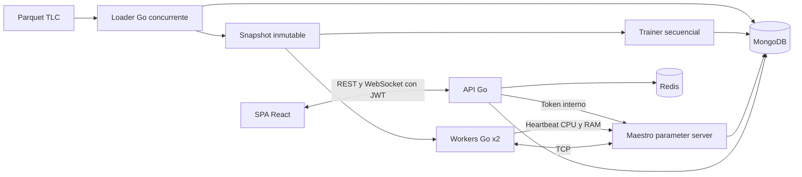

# Cierre de las semanas 7 a 10

> Este documento conserva la evidencia histórica de la computadora anterior. El 13 de octubre se reprodujo la demo en esta computadora: siete contenedores saludables, 1,348,665 viajes, ambos entrenamientos, JWT/WS/Redis, telemetría, navegador y pruebas Go con detector de carreras. La [auditoría actual](AUDITORIA_SEMANA_10.md) y la [evidencia local nueva](VERIFICACION_LOCAL_SEMANA_10.json) registran esa ejecución y las brechas de contexto. Los resultados y capturas de `data/` no se transportan mediante Git.

Referencia: `Cronograma_Proyecto9_Go_BigData_S7-S15_v2.xlsx`, hoja `Hoja 1`, filas 2 a 15. Se conservaron las actividades del archivo; este documento registra su implementación y evidencia local. No modifica el Excel ni equivale al cierre de semanas posteriores.

## Criterios cumplidos

| Semana / fila | Actividad | Estado | Evidencia |
|---|---|---|---|
| 7 / 2 | Dataset >1M y pregunta de impacto social | Completa | TLC enero 2024, 1–15 de enero; 1,348,665 viajes válidos persistidos. Pregunta operativa y límites en API `/impact`, sección Impacto y documento de alcance. |
| 7 / 3 | MongoDB y Redis en contenedores | Completa | Servicios separados, salud comprobada y MongoDB persistente. |
| 7 / 4 | Go, Docker y Compose | Completa | Imágenes versionadas y script de inicio sin requerir Go/Node en el host. |
| 7 / 5 | Arquitectura distribuida y de una máquina | Completa | Mismo módulo Go, loader local concurrente, trainer secuencial y maestro/workers TCP. Arquitectura documentada. |
| 8 / 6 | Bloques, goroutines y channels | Completa | CSV/Parquet, bloques y canales acotados, pool configurable, pruebas de equivalencia. |
| 8 / 7 | Limpieza/parseo e inserción MongoDB | Completa | 2,964,624 filas leídas, 14,905 rechazos y 1,348,665 viajes insertados en selección ampliada. Reutilización idempotente. |
| 8 / 8 | Maestro TCP y parameter server | Completa | Maestro independiente, registro de workers y propiedad única de parámetros. |
| 9 / 9 | Workers con SGD parcial | Completa | Dos procesos workers, misma versión por batch, índices repartidos y 3,960 gradientes aceptados por worker en la ejecución ampliada. |
| 9 / 10 | Sincronización sin carreras | Completa | Agregación por número de ejemplos, identidad tarea/paso/intento, duplicados y timeout rechazados. Detector de carreras aprobado. |
| 9 / 11 | API REST Go y JWT | Completa | Login, sesión, logout, middleware de todas las rutas de proyecto, tokens estrictos y pruebas de revocación/origen. |
| 10 / 12 | WebSocket de predicciones/telemetría | Completa | `/api/v1/events`, snapshots, seguimiento de run y respuesta de predicción correlacionada. Verificado por cliente real y navegador. |
| 10 / 13 | Redis como caché | Completa | Claves versionadas y fallback; prueba real de Redis detenido y restaurado. |
| 10 / 14 | SPA Angular/React con REST/WS | Completa | React 19.3.0, build de producción, recursos locales, REST para datos/control y WS para predicción/estado. |
| 10 / 15 | Panel CPU, RAM y pérdida | Completa | CPU y RSS reales del maestro/workers y curva del objetivo SGD durante entrenamiento, actualizados por WS. |

Son **14 de 14 actividades cerradas en el alcance del cronograma hasta la semana 10**, mediante implementación y verificación local. La comprobación en otra computadora, benchmarks repetidos y demostración de speedup pertenecen a semanas posteriores.

## Datos e impacto

Pregunta: ¿cómo anticipar la actividad de viajes registrada por zona e intervalo para apoyar la planificación del transporte? El uso propuesto es comparar actividad temporal y espacial para ayudar a planificar. No se afirma un beneficio social ya medido.

Fuente fija Yellow Taxi enero 2024. Selección continua desde `2024-01-01T00:00:00-05:00` hasta `2024-01-16T00:00:00-05:00` exclusivo. Se recorrió todo el archivo. Dataset `ds-f16643c248cc24d26b992f45598dd3e8`, intento `2fabf19bf4a02f1ada3f495b`, snapshot SHA-256 `d968869fbb389169a9671661a2e77b42f793bc0b5d44573353ef754b124e1e7b`.

| Medida | Valor |
|---|---:|
| Filas leídas | 2,964,624 |
| Aceptadas y persistidas | 1,348,665 |
| Rechazadas | 14,905 |
| Fuera del período | 1,601,054 |
| Ventanas | 378,720 |
| Ejemplos | 378,457 |
| Train | 264,841 |
| Validación | 56,808 |
| Test | 56,808 |

Se verifica `read = accepted + rejected + outside_period`. Rechazos: zonas desconocidas 14,854, duración no positiva 43 y duración superior a 24 h 8. Se conservó la muestra anterior; `configs/quick.json` permite reutilizarla.

La pantalla presenta conteos por distrito calculados sobre la rejilla del mismo dataset; suman 1,348,665. La concentración en Manhattan describe viajes registrados de Yellow Taxi, no solicitudes totales, disponibilidad de transporte ni desigualdad de acceso. La definición de impacto y sus siguientes validaciones se amplían en [IMPACTO_SOCIAL.md](IMPACTO_SOCIAL.md).

## Arquitectura implementada



Los workers leen una copia del snapshot y reciben índices que particionan cada batch global. Son procesos independientes y comunicación TCP real en un mismo host Docker. No se afirma distribución física de archivos ni despliegue entre máquinas. La contraparte local ejecuta el mismo SGD sin red, además del loader concurrente local.

## Sesión y acceso

`scripts/init-env.ps1` genera contraseña y claves aleatorias si faltan en `.env`; preserva valores ya establecidos. `.env` queda ignorado por Git. Usuario por defecto `demo`; contraseña `DEMO_PASSWORD`. Las imágenes requieren configuración válida y no incorporan secretos. MongoDB, Redis y maestro no publican puertos al host.

JWT HS256, rol operator, emisor y audiencia fijos, expiración obligatoria de 30 minutos, firma y fechas verificadas. La contraseña se compara mediante bcrypt. Cookie HttpOnly/SameSite Strict para navegador; Bearer para scripts. Origin validado en escrituras con cookie y upgrades WebSocket. Login acotado a diez intentos por dirección/minuto. Logout revoca el JWT y cierra el stream. El reinicio de API invalida sus sesiones en memoria. Es un operador de demo local; gestión multiusuario no forma parte de estas actividades.

Pruebas: anónimo 401, contraseña incorrecta 401, JWT modificado 401, emisor/audiencia/algoritmo/rol/fechas inválidos rechazados, origen ajeno 403, logout revocado 401 y stream cerrado con 1008.

## WebSocket y telemetría

Los snapshots contienen secuencia, hora UTC, disponibilidad del coordinador, workers, muestra del maestro, run y modelo. Se envían cada segundo; las mediciones de worker llegan por heartbeat cada dos segundos. El cliente envía `watch` para conservar seguimiento hasta finalizar, o `predict` con ID y solicitud de inferencia. El servidor responde por el mismo canal, con versión del modelo y resultado o error.

Una goroutine lee y una escribe por stream. Mensajes limitados a 8 KiB, cola de ocho solicitudes, máximo de 32 conexiones y escrituras con timeout. Sesiones expiradas/revocadas no pueden seguir solicitando predicciones. El cierre del canal no cancela entrenamientos. La SPA reconecta y usa REST como respaldo de consultas.

CPU procede de tiempo de CPU del proceso Linux, dividido por tiempo transcurrido. 100% equivale a un núcleo, no al total del host. RAM es VmRSS de `/proc/self/status`; heap Go se guarda también como dato separado. Muestras antiguas se muestran como ausentes. La pérdida es el objetivo normalizado del SGD reportado por el maestro, no MAE/RMSE ni una curva simulada.

## Modelo en la selección ampliada

Se entrenaron ambos modos con 120 épocas, batch global 8192, learning rate 0.2, L2 0.00001 y semilla 42. Cada worker aportó 3,960 tareas.

La validación eligió **persistencia**: el candidato SGD no mejoró MAE sin empeorar RMSE frente a esa referencia. Se conserva el artefacto y la evidencia del candidato. El sistema no publica un supuesto éxito predictivo. En test, la versión seleccionada tiene MAE 1.086396 y RMSE 3.553259, iguales a la referencia.

| Ejecución | Tiempo de entrenamiento |
|---|---:|
| Secuencial `run-790d406c6c1e93f1f704f5e6` | 14.236 s |
| Distribuida `run-77d7b266c651bbcd31a945e7` | 18.636 s |

Diferencia máxima de pesos publicados: 0, tolerancia `1e-9`. Como el artefacto seleccionado es persistencia, esta igualdad por sí sola no prueba equivalencia del candidato SGD; la equivalencia del cálculo SGD se verifica además en las pruebas TCP y en la muestra anterior sin fallback. No hay evidencia de speedup. Las ejecuciones de navegador crean nuevas versiones con el mismo método seleccionado.

## Repetición y comprobaciones

```powershell
./scripts/demo.ps1 -SkipDownload
docker compose --profile tools run --rm dev go test -race -count=1 ./...
docker compose --profile tools run --rm dev go vet ./...
./scripts/check-weeks-7-10.ps1
```

Omitir `-SkipDownload` para el primer inicio. El check verifica dataset >1M, JWT, WebSocket, recursos del maestro/workers, suma de impacto, logout y revocación. Los detalles de REST y mensajes están en [DATA_CONTRACT.md](DATA_CONTRACT.md). El resumen comprobado está en [SEMANA_7_10_VERIFICACION.json](SEMANA_7_10_VERIFICACION.json).

La navegación verificó login, cambio de zona, predicción por WS, entrenamiento con dos workers, progreso al 100%, activación de versión nueva y curva de pérdida. La revisión visual incluye escritorio y móvil. Las pruebas Go con detector de carreras y `go vet` pasan. La SPA compila en modo producción. CI está configurado, pero no se afirma que haya corrido remotamente.

La última comprobación del navegador terminó el run `run-cf4eba4db25d6bde15f2d872`, activó su artefacto y mostró la pérdida final 0.048595. Se verificó cierre de sesión y posterior acceso. Evidencia visual local en `data/semana-10-telemetria.jpg` y `data/semana-10-demo-completa.jpg`. El recorrido `scripts/demo.ps1 -SkipDownload` se ejecutó de extremo a extremo, reutilizando el dataset sin duplicar viajes. La prueba final con Redis detenido respondió en 31.03 ms internos y luego se restauró; los siete contenedores quedaron saludables.

## Trabajo posterior

Semanas 11–15: completar comparaciones del loader, ensayos repetidos, escalabilidad, recursos/speedup, ajustes finales y despliegue limpio/otra computadora. La contraparte local y la instrumentación de tiempos ya están adelantadas. Cuatro workers reales, checkpoints, reasignación y mapa son ampliaciones del plan general, no condiciones incluidas en las filas 2–15 de este cronograma.
